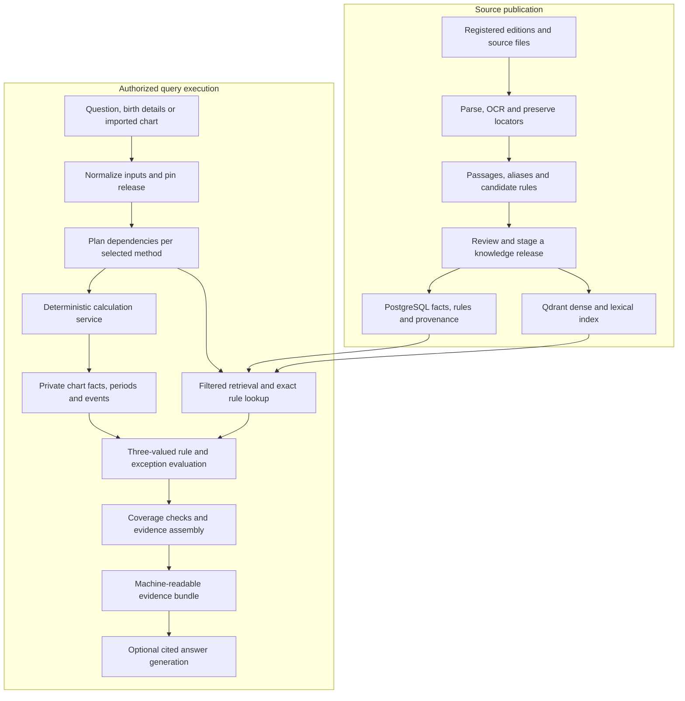

# RAG Design for an Astrology Knowledge Application

Date: 2026-10-17  
Status: Revised design following requirements coverage review; implementation, source acquisition and expert validation remain open.  
Requirements: [rag-gpt.md](../req/rag-gpt.md), the normative scope and acceptance baseline.  
Related independent design: [rag-claude.md](rag-claude.md).

## Purpose

Implement a question-and-chart evidence service for an agentic Indian astrology application. A request can contain birth details, a structured chart or a chart image. The service normalizes inputs, computes required facts, retrieves source-backed knowledge, evaluates applicable rules and returns a typed evidence bundle. Educational search, source comparison and Puranic exploration are additional routes that do not require a personal chart.

Use hybrid search together with structured concepts, conditional assertions, and narrative records. Treat retrieval as a search system with independently measurable quality before adding answer generation. Source fidelity and scientific validation are separate: accurately representing a traditional claim does not establish its predictive validity.

This document owns implementation structure, schemas, algorithms and technology decisions. The requirements document owns collection coverage, user-visible behavior, priorities and acceptance criteria. Technology choices and tuning values remain proposals pending evaluation. Illustrative schemas do not establish astrological rules.

## Scope and staged decisions

- The first complete release includes chart-backed retrieval for declared Parashari and BNN profiles, attributed contemporary Indian interpretation, and educational/narrative routes. A search-only milestone is an intermediate engineering checkpoint.
- Proposed foundation: Haystack, Qdrant, PostgreSQL, durable source storage, and replaceable model interfaces.
- Local embeddings, reranking, and answer generation are supported deployment choices; frontier API calls are optional.
- Deterministic chart, panchanga, period and transit calculation and three-valued rule evaluation are core services; only the techniques required by the query are executed.
- Use one orchestrating agent with bounded tools initially. Add graph infrastructure or more complex orchestration only for demonstrated needs.

Additional Indian methods use the same registries and contracts but become active only after their calculations, source coverage and applicability fixtures are ready. Western/psychological techniques remain an optional separate profile. No phase silently substitutes one method for another.

### Review findings addressed

| Finding in the previous design | Resolution |
|---|---|
| Personal charts were both central to the workflow and described as optional/later | Make question-plus-chart execution core and reflect it in the architecture and delivery gates |
| Collection requirements, source lists and implementation choices were interleaved | Move the inventories and acceptance baseline to the requirements document; keep implementation contracts here |
| The architecture diagram omitted calculation and applicability | Connect private inputs, deterministic tools, structured rules and evidence assembly explicitly |
| A schematic evidence example declared two methods but contained only one bundle | Define one result per selected method, typed references and explicit partial/failure/coverage states |
| Release consistency and failure behavior were general advice | Specify publication snapshots, dependency closure, budget handling, revocation checks and replayable traces |
| Coverage had no requirement-to-design links | Add a traceability matrix and end-to-end acceptance scenarios |

## Recommended starting architecture

Use hybrid retrieval (keyword search plus embeddings), rank fusion, and reranking, supplemented by structured assertion lookup. Separate ingestion from querying so they can scale, retry, and fail independently.



Store original documents durably and maintain document metadata and processing status in a database. Search indexes are rebuildable derivatives, not the source of truth. The keyword and vector indexes may live in the same search service.

### Question-driven execution layers

Build a question-driven system with four cooperating layers:

1. **Calculation:** reproducible astronomical positions, chart transformations, calendars, periods, and event times.
2. **Knowledge:** cited definitions, interpretation rules, exceptions, commentaries, stories, and worked examples.
3. **Applicability:** structured predicates that determine which retrieved rules apply to the supplied chart and selected tradition.
4. **Synthesis:** an agent workflow that assembles relevant facts and evidence, preserves disagreements, and produces a cited interpretation.

The LLM should select tools, interpret evidence, and explain results. Numerical positions and period boundaries should come from tested calculation tools. Searching prose for a person's current mahadasha is not a substitute for computing it.

“All relevant knowledge” means coverage of the question's dependencies within the chosen methods and context budget. It does not mean returning the entire corpus. A useful result includes applicable rules, prerequisites, exceptions, contrary evidence, and unresolved gaps.

Terminology assumptions: BNN means **Bhrigu Nandi Nadi**, associated here with R. G. Rao's published work. “Modern” is ambiguous: support contemporary Indian interpretations and, separately if wanted, Western/psychological techniques. These need distinct profiles; modern does not automatically mean tropical astrology.

## Domain knowledge model

Keep four knowledge layers distinct and linked through stable identifiers and passage-level evidence.

| Layer | Contents | Representation |
| --- | --- | --- |
| Concepts | Chart types, houses, signs, grahas, nakshatras, terminology | Canonical entities, aliases, scoped definitions |
| Interpretations | Relationships and conditional rules | Source-backed assertions with prerequisites and exceptions |
| Narratives | Puranic episodes, characters, themes, variants | Episode records linked to source passages and attributed interpretations |
| Calculations | Positions, chart placements, periods and events | Versioned outputs from deterministic tools |

### Entities and terminology

Start with entity types such as ChartType, House, ZodiacSign, PlanetOrGraha, Nakshatra, InterpretiveRule, TraditionOrSchool, Text, Edition, Passage, StoryEpisode, Character, and Theme. Keep houses, signs, and placements in a particular chart separate; shared vocabulary does not make them interchangeable.

Maintain preferred labels, language, script, original spellings, transliterations, and searchable aliases. For example, `chart:navamsha` can have aliases `Navamsha`, `Navamsa`, `Navāṃśa`, and `D9`. Resolve ambiguous mentions from context; do not automatically merge every matching term. Separate the named concept from differing source definitions of it.

### Conditional assertions

Represent a relationship as an assertion with scope and evidence, rather than a universal entity-to-entity edge. A simplified record is:

```yaml
assertion_id: assertion:123
subject: entity:planet-a
relationship: has_interpretation_in
object: entity:house-b
scope:
  tradition: tradition:example
  chart_type: chart:example
conditions:
  - "Source-specific prerequisite"
interpretation: "Paraphrase of the supported interpretation"
qualifications:
  - "Exception or limitation stated in the source"
evidence:
  - passage_id: passage:456
    source_id: edition:789
    locator: "chapter / verse / page"
review_status: human_reviewed
```

Retain original wording alongside paraphrases. Preserve differing assertions from different sources; never silently overwrite them or resolve them by majority vote. An unspecified tradition is unknown, not universal. Track extraction confidence, review status, source preference, and applicability separately rather than collapsing them into one score.

Preserve source conditions as reviewed text for explanation. For the core chart-backed path, also encode supported conditions as typed predicates with AND/OR logic and explicit exceptions. Treat missing inputs as unknown, not as satisfied conditions. Version predicates and validate rule evaluation against expert-reviewed cases.

### Narrative records

Store each coherent story episode with its source work and edition, precise locator, characters, events, source-grounded summary, themes, and links to alternate versions. Keep three claims separate: the episode occurs in a source; a commentator associates it with an astrological concept; the application uses it as a teaching analogy. Cite the original episode for its narrative and the commentator for the association. Generated analogies must be labeled and must not become indexed source evidence.

Gather narrative passages with work/recension, book/canto, chapter, verse range, language, translation and commentator. Preserve variants rather than merging different accounts into a synthetic “original” story.

For example, Bhagavata Purana 8.9.24–26 is a precisely locatable source for the Rahu/nectar episode. [Verse 24](https://vedabase.io/en/library/sb/8/9/24/), [verse 26](https://vedabase.io/en/library/sb/8/9/26/).

Represent separate assertions:

1. What the narrative says.
2. Which interpreter connects it to a graha, nakshatra or symbolic theme.
3. Whether a named astrological source gives a chart interpretation rule based on it.
4. Whether a source prescribes a practice, and what efficacy claim it makes.

A story about Rahu does not by itself establish a prediction about a person's job, marriage or health. Retrieve stories for explanatory or devotional questions, or as clearly attributed optional symbolism. Do not let their lexical richness crowd out calculation and rule evidence in predictive retrieval.

### Source registry and provenance

Record work, author or attributed author, edition, translator, language, script, tradition, source category, rights, source URI, and review status. Distinguish original texts, translations, commentaries, teaching transcripts, and modern syntheses. Record whether a tradition or attribution is curator-assigned or explicitly supported by the source.

Use stable passage IDs with chapter, verse, page, or timestamp locators. Distinguish printed page numbers from PDF page indices. Link translations and commentaries to original passages where verified, without treating them as identical content. Passage locators and source versions must remain resolvable after reindexing.

Suggested PostgreSQL records: sources/editions, source_versions, passages, entities, aliases, entity_mentions, assertions, assertion_evidence, story_episodes, episode_links, and review_events. A graph database is optional; relational joins can support the first relationship lookups.

Extend the schema with `method_profiles`, `calculation_profiles`, `capabilities`, `topic_dependency_maps`, `rule_versions`, `rule_dependencies`, `knowledge_releases`, `chart_inputs`, `chart_facts`, `periods`, `events`, `query_runs`, `rule_decisions`, `evidence_bundles` and dependency/deletion records. Use foreign keys and unique versioned identifiers; private tables enforce owner/tenant access independently of public corpus permissions. This is a logical model, not a migration specification.

### Extended object contracts

- **SourceWork / Edition / Passage:** stable passage locator, page image, original text, transcription, translation and commentary as linked but distinct objects.
- **Entity:** graha, rashi, bhava, nakshatra, pada, deity, star, period system, calendar element, topic or method.
- **Assertion / Rule:** a source's statement, prerequisites, qualifiers, exceptions and applicability.
- **CalculationSpec / Chart / ChartFact:** inputs, method versions, numeric/derived facts and uncertainty.
- **TemporalInterval / Event:** period or transit, boundary semantics, time standard, location dependencies and precision.
- **Narrative / Practice:** stories, symbolism and remedies with their own evidence class.
- **CaseStudy:** source chart, interpretation, prediction and outcome provenance, if available.
- **QueryPlan / EvidenceBundle / AnswerClaim:** what was requested, fetched, tested and ultimately asserted.

### Passage and rule metadata

Every retrievable item should carry:

`id`, `source_work_id`, `edition_id`, `author_or_attribution`, `translator`, `commentator`, `language`, `script`, `school`, `lineage`, `method_variant`, `topics`, `entities`, `chart_scope`, `reference_frame`, `evidence_class`, `page_or_verse_locator`, `parent_section_id`, `source_uri`, `rights_status`, `acl`, `content_hash`, `parser_version`, `ocr_quality`, `review_status`, `reviewer`, `supersedes`, `contradiction_group`.

Use evidence classes such as `astronomical_calculation`, `traditional_rule`, `commentary`, `practitioner_hypothesis`, `narrative`, `reported_case`, and `empirical_study`. Keep source fidelity, extraction quality, applicability and empirical support as separate fields; a single confidence score hides the distinction.

### Executable rule representation

```yaml
rule_id: schematic_rule_001
status: draft_unreviewed
school: selected_school
lineage: selected_lineage
method_variant: selected_variant
topics: [career]
chart_scope: [D1]
requires:
  - feature_path: chart.D1.body_A.sign
  - feature_path: chart.D1.body_B.sign
predicate:
  operator: same_sign
  arguments: [chart.D1.body_A, chart.D1.body_B]
interpretation:
  statement: Source-attributed interpretation goes here.
  modality: conditional
qualifier_rule_ids: []
exception_rule_ids: []
contradicting_rule_ids: []
source_passage_ids: [edition_001_passage_001]
extraction_provenance: human_or_model_then_reviewed
```

This deliberately contains no real prediction. Production rules must not acquire fabricated source citations from a model-generated example. Store ambiguous prose as prose with `requires_review`; do not force it into a predicate.

Applicability uses at least three states: `satisfied`, `not_satisfied`, `unknown`. Missing degrees, unknown birth time or unsupported methods must yield unknown rather than false. A fulfilled formation condition and a source's interpretation of it remain separate claims.

### Typed relationships

Examples of typed graph edges:

`planet OCCUPIES sign`, `planet LORD_OF house`, `planet IN_NAKSHATRA mansion`, `planet DISPOSITED_BY planet`, `planet ASPECTS planet`, `rule REQUIRES feature`, `rule QUALIFIED_BY rule`, `rule CANCELLED_BY rule`, `passage SUPPORTS assertion`, `assertion CONTRADICTS assertion`, `story ASSOCIATED_WITH deity`.

All school-dependent edges carry method and scope. Keep the reusable knowledge graph separate from each person's private chart graph. Graph traversal can begin with indexed relational tables; a separate graph database is optional until traversal workloads justify it.

## Coverage ownership and method registry

The [requirements inventory](../req/rag-gpt.md#5-knowledge-acquisition-inventory) owns the categories to collect; the [method bundles](../req/rag-gpt.md#6-method-bundle-inventory) own target traditions; the [acquisition candidates](../req/rag-gpt.md#7-acquisition-candidates) guide the source register. Their full tables are maintained there rather than copied into this design.

Implement `MethodProfile` as a versioned record containing `school`, `lineage`, `interpretation_variant`, compatible calculation-profile IDs, supported topic maps, feature dependencies, predicate library/version, source preferences, approved rule-set ID, and status (`draft`, `validated`, `active`, `withdrawn`). Never infer active support from the existence of a book or a generic model's familiarity with the topic.

Each `(method, topic)` capability record lists required and optional feature/rule families, approved sources, evidence gaps, fixtures and activation status. Begin with reviewed Parashari, BNN and contemporary Indian mappings. Keep BNN relative planetary links separate from Parashari house/aspect predicates, and encode a hybrid as its own named variant. A source may span schools: attach attribution at assertion/passage level, not only at document level.

`TopicDependencyMap` expands a question into chart features, period/event needs and rule families. Version this map and include its ID in every query plan. Cyclic dependencies are detected and bounded. A registry entry can describe an Expansion capability without making it available to the runtime.

## Ingestion

1. Register the edition and rights before processing.
2. Preserve original files, page order, headings, verses, diagrams and tables.
3. OCR/transcribe original scripts; retain the page image and extraction quality. Audit numbers, negations, degrees and chart labels especially carefully.
4. Align original passages, translations and commentary without conflating their authorship.
5. Resolve entities through a curated multilingual lexicon. Examples: Shani/Saturn, Guru/Brihaspati/Jupiter, Dasha/Dasa, Navamsha/Navamsa. Preserve originals; aliases support search.
6. Form chunks around meaningful units: verse plus necessary commentary, complete rule plus exceptions, table plus headers, or case chart plus explanation. Use parent/child retrieval for longer units.
7. Extract candidate assertions, prerequisites, methods and contradictions. A model may propose them; review gates determine whether they become approved executable rules.
8. Index prose with hybrid lexical/vector search; store structured tables and predicates in the relational/rule layer; connect both by stable IDs.
9. Evaluate source fidelity and rule applicability before publishing the new corpus version.

Keep candidate assertions out of the authoritative rule store; retrieved unreviewed source text must retain its review status. Publish a consistent source/index/knowledge release so obsolete assertions cannot survive an update.

Preserve headings, lists, tables, code boundaries, page numbers, and source links. Retain table headers with relevant rows. Validate extraction on actual documents, especially scanned PDFs and complex tables.

Use idempotent processing, bounded retries, and a failed-document queue. Prevent duplicate ingestion with source identifiers and hashes. Updates must retire obsolete chunks; deletion must propagate to indexes and caches. Avoid exposing partially indexed document versions by using a publication marker or staged index switch.

### Suggested chunk metadata

```json
{
  "chunk_id": "edition-123:v4:section-2:chunk-1",
  "document_id": "edition-123",
  "document_version": 4,
  "text": "...",
  "title": "Example Astrology Commentary",
  "section_path": ["Chart Types", "Example Section"],
  "passage_ids": ["passage:456"],
  "language": "en",
  "tradition_ids": ["tradition:example"],
  "entity_ids": ["chart:navamsha"],
  "source_category": "commentary",
  "review_status": "human_reviewed",
  "source_uri": "...",
  "page": 7,
  "tenant_id": "tenant-42",
  "access_groups": ["employees"],
  "updated_at": "...",
  "content_hash": "...",
  "embedding_model": "...",
  "pipeline_version": "..."
}
```

Also retain parent-section identifiers, parser and chunker versions, embedding configuration, and ingestion timestamps where useful. Access rules must come from trusted source metadata and application identity.

## Storage responsibilities

| Store | Contents | Why |
|---|---|---|
| Object/file store | Source scans, source files, page images, original uploads | Auditability and reprocessing |
| Relational store | Editions, rules, profiles, exact chart facts, periods/events, cases, evaluation sets | Numeric/range queries, joins, integrity and provenance |
| Hybrid search index | Explanatory passages, commentary, definitions and searchable case descriptions | Semantic and exact-term retrieval |
| Relation layer | Rule dependencies, exceptions, source links and planet chains | Multi-step expansion and explanation |
| Private session/profile store | Consented user inputs, chart references and conversation intent | Personalization and access control |

Do not embed every minute of every ephemeris or each possible chart combination. Calculate on demand and cache by inputs and calculation profile. Cache shared astronomical events only where their frame/location settings permit reuse. Keep private charts out of the shared public knowledge index.

### Coherent publication and withdrawal

A `KnowledgeRelease` manifest binds source-version IDs, approved rule versions, topic-map versions, extraction/chunking configuration, embedding/sparse configuration and a physical index generation. Stage immutable passages/rules and the corresponding search collection, validate expected counts/reference integrity and acceptance fixtures, then atomically mark the manifest active in PostgreSQL. Use an idempotent job/outbox to reconcile index writes and failures; do not assume PostgreSQL and Qdrant share a transaction.

Queries pin a release manifest and its physical collection, rather than repeatedly resolving a mutable “current” alias. Keep old generations long enough for bounded in-flight requests and rollback. A failed staging operation never becomes queryable. Calculation profiles/artifacts are pinned separately and checked against the selected method's compatible versions.

Withdrawal and authorization override snapshot consistency. Tombstone withdrawn evidence and revoked chart/source access immediately in the authoritative store; apply that deny overlay during all passage/rule/context fetches and again before external model transmission and response delivery. If access changes during execution, remove the affected evidence and revalidate the result or abort it. A pinned old release or rollback cannot restore access.

Track derived dependencies from source version to chunk, assertion, narrative link, summary and stored bundle. Withdrawal invalidates dependent cache entries and stored-answer delivery; historical traces can retain permitted metadata but cannot keep serving withdrawn excerpts. Physical cleanup follows the declared retention policy. Backups use documented expiry, and restore reapplies deletion tombstones before serving requests.

## Chunking strategy

Prefer document structure and semantic boundaries over arbitrary token boundaries. Keep rules with prerequisites, exceptions, and examples; preserve verse boundaries and links to associated commentary. Chunk narratives by coherent episodes and retain table headers. For long episodes, use linked child passages and a parent episode record. Generated summaries can help navigation but do not replace primary evidence.

As an initial experiment, use approximately 300–700 tokens per chunk, with modest overlap where passages continue across boundaries. Tune these values against retrieval quality, duplication, latency, and context cost.

Link smaller searchable chunks to larger parent sections so retrieval can expand context when needed. If chunks are ambiguous in isolation, experiment with concise contextual text before embedding and keyword indexing. Preserve the original source text and distinguish generated context from source evidence.

## Query and retrieval

Authenticate the requester and derive access filters before any evidence lookup. Educational and narrative questions skip calculation steps that are irrelevant to their intent.

1. **Resolve intent:** distinguish educational, natal, timing, compatibility, muhurta, prashna, narrative and remedy questions; extract time window, entities, school and missing inputs.
2. **Select methods:** choose declared bundles. If a school is unspecified, apply a visible configured default rather than hiding a synthesis.
3. **Validate inputs:** reconcile imported charts and conventions; flag unknown degrees, times and extraction uncertainties.
4. **Build dependencies:** map the topic and method to required chart features and rule families. A career query may require career-related houses/lords, selected vargas, active periods and transits under the chosen method.
5. **Calculate facts:** obtain needed natal features, period intervals and event times. Compute different profiles separately when comparing methods.
6. **Retrieve candidates:** combine exact rule/entity lookup, school-filtered hybrid passage search and relevant case search. Apply access controls before retrieval results reach the agent.
7. **Check applicability:** evaluate predicates on chart facts; expand prerequisites, exceptions, cancellation and contradictory rules to a bounded depth. Retrieve the source passages for every rule that matters. Log why each candidate was accepted, rejected or left unknown.
8. **Seek contrary evidence:** explicitly search for source-specific mitigations, alternate readings and relevant non-matches. Similarity search alone tends to reinforce the initial hypothesis.
9. **Check coverage:** if a required feature or rule family is missing, perform a targeted tool call/retrieval retry. Limit iterations, latency and context size; report unresolved gaps.
10. **Package evidence:** pass the synthesis agent a compact typed bundle with calculation facts, matched rules, qualifying rules, contrary evidence, uncertainties and citations.
11. **Synthesize and verify:** explain interpretations separately by method, then describe agreements/disagreements. Validate source locators and chart references before returning the answer. Treat retrieved instructions as untrusted document content, with permissions and allowed tool actions enforced by the workflow.

Dependencies are explicit. Retrieval can discover that a rule requires an uncomputed feature, trigger a calculation, then evaluate the rule. The system should not need to compute every supported chart and technique for every question.

| Component | Role |
| --- | --- |
| Keyword retrieval, such as BM25 | Names, technical terms, transliterations, and verse references |
| Vector retrieval | Concepts expressed with different wording |
| Metadata filters | Tenant, permissions, tradition, work, edition, language, and source category |
| Structured lookup | Entities, scoped assertions, rule conditions, and story relationships |
| Rank fusion | Combine rankings from different retrieval methods |
| Reranker | Estimate which passages best answer the query |
| Context assembly | Select useful, nonredundant evidence within budget |

For an initial experiment, retrieve 20–50 candidates per method, merge and rerank. Reserve context for required rule families, source passages and exceptions before filling remaining space with roughly 5–10 optional explanatory passages. These are tuning values rather than completeness criteria. If required evidence does not fit, summarize with source links only where qualifiers survive, or mark the affected conclusion partial. Measure quality and latency independently.

Vector similarity is not answer confidence. A similar passage may fail to support the requested answer. Do not adopt a universal similarity threshold without calibration.

Route source-specific questions to the requested work and edition. For comparisons, retrieve each requested source independently so the most numerous source cannot crowd out another. Do not use publication recency as a universal proxy for authority. Apply access controls to structured records and every fetched evidence passage as well as vector results.

## Agent workflow and tools

Start with one orchestrating agent and explicit typed tool inputs and outputs.

| Tool | Responsibility |
| --- | --- |
| `resolve_entities` | Resolve aliases and report ambiguous concepts |
| `search_passages` | Authorized hybrid search with source and tradition filters |
| `get_assertions` | Fetch reviewed relationships, conditions, and evidence IDs |
| `get_source_context` | Fetch original wording and surrounding passages |
| `find_story_episodes` | Retrieve episodes, variants, and attributed associations |
| `compare_sources` | Collect separately attributed evidence for comparison |
| `normalize_chart_input` | Validate birth data or extract imported fields, retaining original artifact, settings and uncertainty |
| `calculate_features` | Compute requested features under an explicit calculation profile; return provenance, unknowns and unsupported capabilities |
| `calculate_periods` | Return active/overlapping dasha intervals with birth balance and declared year basis |
| `find_transit_events` | Solve requested event conditions over a bounded window, retaining repeated crossings |
| `evaluate_rules` | Execute approved predicates and dependent exceptions on authorized facts |
| `assemble_evidence` | Validate references, required-family coverage, method completeness and context budget |

Use a bounded plan: resolve scope, retrieve, follow relevant relationships, verify conditions and disagreements, compose, and validate citations. Configure limits on tool calls, retrieval rounds, context tokens, elapsed time, and cost. On exhaustion, explain what evidence is missing. Record tool outputs, evidence IDs, and validation results for audit. The query agent cannot approve or publish extracted assertions; ingestion review is a separate workflow.

Add graph traversal or GraphRAG only when relationship-heavy or corpus-wide questions outperform the baseline in evaluation. Add durable agent orchestration when workflow persistence or branching requires it. Neither a graph database nor multiple agents is a prerequisite.

### Workflow roles

Use a coordinator and narrowly scoped roles/tools: input validator, calculation service, query planner, method-specific analyst, evidence/contradiction checker and final synthesizer. These can be workflow nodes rather than independent LLM agents; calculation and deterministic rule checks do not require an LLM.

Only dispatch a school analyst when the user selected it or the configured scope calls for it. Parallel interpretations are independent evidence views, not a vote that makes predictions more certain. The evidence checker should test claims against records, rather than merely ask a second model whether the first sounds plausible.

### Query state and bounded dependency execution

Persist a `QueryRun` with trusted identity/access-policy version, selected chart references, normalized as-of/window, method-profile IDs, calculation-profile IDs, knowledge-release ID, topic-map versions, unresolved inputs, feature/rule work queues, evidence references, coverage checklist and remaining budgets. Persist structured decisions and tool results, not hidden model reasoning. Requests and artifact writes use idempotency keys.

The coordinator follows explicit states:

`received → authorized → normalized → planned → calculating/retrieving → evaluating → checking_coverage → packaging → optional_generating → validating → delivered`.

At any stage it can terminate as `needs_input`, `unsupported`, `partial` or `failed`. Independent method results survive another method's failure. Multi-turn requests create a new run referencing reusable authorized artifacts; changed chart/time/profile inputs invalidate affected calculations and decisions.

The dependency executor computes a closure of required features, rule families and their prerequisites. Retrieve reviewed rules by topic/entities as well as semantic passages; newly discovered dependencies return to the work queue. Check a visited/version set to stop cycles. Budget counters bound calls, retries, dependency depth, window size, elapsed time, tokens and cost. A repeated request for an unavailable fact does not create an unbounded loop.

When a required fact is missing, ask only for the fields necessary to unblock that question and return a bundle identifying the gap. When a calculation fails, preserve unrelated evidence and the specific failure; do not substitute an LLM calculation, house method or default dasha variant. Retrieval with no evidence is different from a failed lookup. Unsupported profile, missing input, no matching rule and budget exhaustion have separate reason codes.

### Rule evaluation mechanics

An allowlisted predicate library operates on typed facts with units, chart scope and reference frame. It does not execute code from source text. `AND` returns false if any operand is false, true if all are true, otherwise unknown; `OR` returns true if any operand is true, false if all are false, otherwise unknown. `NOT unknown` remains unknown. Missing input is never coerced to a satisfied condition.

Record the formation result independently from qualification/cancellation status. A matching yoga with an unevaluated cancellation is a match with unresolved qualification, not a fully endorsed interpretation. Evaluate supporting rules and exception rules under the same profile and source scope. Cycle/depth/budget failures yield unresolved dependencies and partial coverage. Source disagreements remain separate decisions rather than being reconciled by a vote.

`RuleDecision` contains `rule_version_id`, `profile_id`, `chart_ref`, `formation_result`, per-predicate results, `fact_refs`, `qualifier_decisions`, `exception_decisions`, `source_passage_refs`, `unresolved_dependencies` and machine-readable reason codes. This makes applicability replayable without relying on an agent's prose explanation.

### Context selection and coverage

Evaluate a checklist per `(method, topic, required_family)` with states `satisfied`, `insufficient`, `unavailable`, `budget_omitted` and `not_applicable`. Coverage means support for the declared plan, not exhaustive corpus recall. The checker verifies evidence presence and applicability separately: a relevant passage may still describe a nonmatching rule.

Keep required source passages, material qualifiers and contrary evidence together as an evidence unit. Rerank optional explanations/cases after reserving those units. Expand parent sections or fetch neighboring passages where a rule is ambiguous. If a required unit cannot fit the downstream context, mark that conclusion incomplete; never silently keep the favorable rule while dropping its exception. Each selected method gets its own coverage record, including when it is unsupported.

### Request and artifact interfaces

Expose an application API such as `POST /evidence` for question, chart/birth input, methods, language and time scope; `GET /evidence/{run_id}` for an authorized stored result; and an optional `POST /answers` consuming a bundle ID. Tool names describe application interfaces, not claims of built-in framework methods. Authorization context is injected server-side rather than accepted from LLM-supplied JSON.

The normalization result identifies `computed`, `imported`, `conflicting`, `unknown` and `unsupported` fields. Each `ChartFact` carries `id`, typed value/units, body/chart/reference frame, input and calculation-profile hashes, provenance, engine/data versions, uncertainty and validity interval when relevant. Imported facts retain their original declared settings and extraction provenance; no default is retroactively asserted as a known import setting.

Period/event records use UTC instants and half-open intervals `[start, end)`, retain the display zone and computation tolerance, and reference the parent period or event definition. Temporal queries use exact interval/range lookup; text embeddings are not the authority for active periods or numerical conditions.

## Chart calculation and interpretation

The chart-backed path is a core service. Educational passage search bypasses it. Requests use only the capabilities advertised by their selected method and calculation profiles.

Use tested calculation software, keep birth details private, and separate calculated observations from traditional interpretations. Engine selection and licensing remain implementation decisions.

### Birth details and chart imports

Gather:

- Birth date, original calendar and unambiguous date notation.
- Local clock time, precision, estimated uncertainty interval and provenance: certificate, family memory, rounded time, rectified estimate, or unknown.
- Original place string, resolved location ID, latitude/longitude, and elevation if required by the calculation.
- Historical time-zone identifier, applied UTC offset, DST ambiguity resolution and time-zone database version. Never apply today's offset to all historical births.
- Original chart file/image and its declared settings if the user supplies a chart.
- Question text, explicit as-of date, requested time window and relevant location. Resolve relative expressions such as “next year” against a recorded query date and user time zone.
- Selected tradition/profile and response language. Collect personal context only when it helps interpret the question; do not make names, caste, religion or gender mandatory calculation inputs.

IANA provides historical civil-time rules, but its scope and historical limitations must be respected, especially for older births. Use corroborating historical records where needed. [IANA time-zone database](https://www.iana.org/time-zones), [database theory and scope](https://ftp.iana.org/tz/code/theory.html).

For chart images: detect North/South/East Indian layouts, extract sign labels and placements, retain field-level extraction confidence, and validate against any printed position table. Missing degrees cannot be recovered reliably from a schematic chart. If birth details are supplied, independently calculate and reconcile differences. Do not invent birth time, positions, vargas or dasha dates to complete an image import.

Normalize imports through layout-specific adapters into `ImportedChart`, with per-field value, source bounding box/table cell, confidence and original labels. Separate sign numbers from house numbers before mapping body labels. Parse structured imports through a versioned schema with units, chart type and declared conventions. Validate body identity, allowed ranges and internal consistency. Retain conflicting alternatives rather than selecting the value that best fits the intended reading; request correction only for fields required by the question.

Resolve local times through a versioned time-zone/gazetteer adapter. DST folds produce candidate instants; gaps produce invalid-input status until clarified. Older local-time assumptions carry their own evidence and uncertainty. The result is an immutable normalized-input artifact; changing the selected location/instant creates a new artifact and invalidates dependent calculations.

### Versioned calculation profile

Persist at least:

```yaml
profile_id: parashari_profile_v1
zodiac: sidereal
ayanamsa: {implementation_id: explicitly_selected, version: pinned}
position_origin: geocentric
coordinate_frame: explicitly_defined
position_corrections: explicitly_defined
node_model: mean_or_true_explicitly_selected
house_method: explicitly_selected
varga_algorithms: {D9: named_variant, D10: named_variant}
dasha_method: {id: named_variant, year_basis: explicitly_selected}
panchanga: {sunrise_definition: named_definition, calendar_region: selected}
ephemeris: {engine: selected, version: pinned, data_hash: recorded}
time_model: {tzdb_version: pinned, delta_t_model: recorded}
```

This is a schema sketch, not executable configuration. Each school profile can require a different calculation profile. Keep input provenance separate from computed output provenance, and store original imported values beside recalculated values.

Swiss Ephemeris documents planetary positions, houses, sidereal modes, stars, eclipses and time conversion. Select modes explicitly rather than accepting defaults. Its licensing choices are an implementation dependency to resolve before distributing or operating a public service. [Programmer documentation](https://www.astro.com/swisseph/swephprg.htm).

JPL Horizons is useful as an independent astronomical reference. Compare matched origins, time scales, reference frames and corrections; raw outputs from different conventions are not directly comparable. [Horizons manual](https://ssd.jpl.nasa.gov/horizons/manual.html).

### Uncertainty is part of the data

For uncertain birth time, calculate representative charts and locate relevant boundary crossings over the full input interval. Report which features are stable, which are sensitive, and which cannot be established. A few samples alone cannot prove stability across the interval.

For date-only births, restrict output to features that remain established across plausible time/location assumptions. Rectification should be a separate hypothesis workflow with its own evidence and validation, not an invisible preprocessing correction. Never change birth time merely to make a requested interpretation fit.

### Calculation domain specifications

#### Panchanga is interval data

Store the five limbs at the relevant instant and their transitions, plus local sunrise/sunset and the convention used to assign a calendar day.

The reference registry should enumerate 30 tithis across two pakshas, seven varas, 27 standard nakshatras, 27 nitya yogas, and 11 named karanas with their occurrence sequence. Link each entry to its names, definitions, source-specific qualities and applicable activities; do not infer a quality from its numerical index.

Common equal-sector definitions use:

- Tithi index: `floor(mod(moon_longitude - sun_longitude, 360) / 12) + 1`.
- Karana half-tithi index: `floor(mod(moon_longitude - sun_longitude, 360) / 6)`; map to karana names using the correct repeating/fixed sequence.
- Nakshatra index: `floor(sidereal_moon_longitude / (360/27)) + 1`.
- Nitya yoga index: `floor(mod(sidereal_sun_longitude + sidereal_moon_longitude, 360) / (360/27)) + 1`.
- Pada: quarter of the relevant nakshatra sector; vara/day assignment follows the declared convention.

Use consistent coordinates, full precision and explicit half-open boundary intervals. Find transition times numerically; the angular sectors do not imply constant clock durations. Optional Abhijit schemes need their own boundaries and use cases rather than replacing the standard 27-sector calculation globally.

Also gather amanta/purnimanta and regional month rules, solar months, ayana, ritu, samvatsara conventions, skipped/repeated tithi handling, and location-specific observance rules. Rahu Kalam, Yamaganda, Gulika Kalam, Abhijit Muhurta, Choghadiya and similar intervals are additional features with their own definitions.

The five-limb terminology has an institutional historical reference in [The Indian Calendar, hosted by IGNCA](https://ignca.gov.in/Asi_data/34958.pdf). The formulas above describe the proposed common calculation convention; regional observance rules require additional sources.

Keep **nitya yoga**, the panchanga limb, distinct from **yoga**, a chart combination. Keep the compatibility classification called **nadi** distinct from Nadi astrology.

#### Dasha is a framework; mahadasha is a level

Do not model “dasha” and “mahadasha” as unrelated subject areas. For each supported system, gather eligibility rules, starting reference, period order, duration arithmetic, birth balance, year-length convention, nested-period definitions and exceptions.

For a standard Vimshottari implementation, specify the lunar nakshatra starting lord, remaining fraction at birth and the usual 120-year cycle: Ketu 7, Venus 20, Sun 6, Moon 10, Mars 7, Rahu 18, Jupiter 16, Saturn 19, Mercury 17. Use the sequence cyclically from the correct starting lord. Under the standard proportional subdivision, an antardasha duration is `mahadasha duration × antardasha lord years / 120`. Pin the day/year conversion convention rather than rounding years to calendar anniversaries.

Represent periods as a tree: mahadasha → antardasha/bhukti → pratyantardasha → further supported subdivisions. Record UTC interval boundaries, local display zone, parent period, sequence, calculation version and uncertainty.

Retrieve interpretations for the actual active lords, their chart conditions, relationships, domain and selected time horizon. Computing finer subdivisions does not itself justify finer predictive precision. Add Yogini, Ashtottari, Kalachakra, Chara, Narayana and other systems only with their own validated specifications and eligibility rules.

An author-provided reference covering several dasha and chart techniques is [P. V. R. Narasimha Rao's textbook download page](https://vedicastrologer.org/articles/astro_books.htm). It is a particular modern synthesis, not a universal specification for every school.

#### Relationships and strengths need definitions

Store sign-based conjunction, angular closeness, applying/separating contact, graha drishti, rashi drishti and school-specific relationships as different predicates. An aspect needs an aspect-system ID; an angular aspect may also need an orb. “Second from” must identify its reference planet/sign/house, counting direction and whether the relation is inclusive.

Natural benefic/malefic, functional role for an ascendant, dignity and measured strength are separate properties. Do not compress them to a single universal “good/bad” score. Collect source-specific definitions of combustion, retrogression interpretation, graha yuddha eligibility, friendship, exaltation/debilitation, moolatrikona, vargottama, sandhi and gandanta.

For Shadbala or Ashtakavarga, retain components, units, algorithm variants and intermediate results. A prose statement that a planet is “strong” is not interchangeable with a particular numerical threshold.

#### Varga registry

Maintain algorithms and source-defined scope for the conventional shodashavarga set: D1, D2, D3, D4, D7, D9, D10, D12, D16, D20, D24, D27, D30, D40, D45 and D60. Add other divisions only as explicitly supported extensions.

Start implementation with D1, D9 and D10 for the initial chosen use cases. Treat D7, D24, D12 and the other divisions as question-dependent additions. Encode alternative construction methods as separate variants. Preserve the distinction between an astronomical longitude and a derived divisional placement. Restrict conclusions that depend on unstable varga placements when birth time is uncertain.

#### Transit and boundary search

Expose event definitions for sign/nakshatra/pada crossings, stations, angular contacts and supported astronomical events. Each definition specifies bodies/reference points, coordinate profile, angle or threshold, requested window, tolerance and applicable location. Use deterministic ephemeris sampling with adaptive bracketing, longitude unwrapping and root refinement; station detection must also handle tangencies and direction changes rather than checking only sign changes of a contact function.

Partition retrograde motion at stations and solve each segment so multiple contacts are retained. Verify convergence, deduplicate only events within the declared tolerance and return an explicit unresolved interval when the solver cannot establish a result. Bound window length and numerical work. A daily position cache can assist bracketing but cannot establish that an exact contact did or did not occur.

The same boundary search underlies birth-time sensitivity for sign, house, nakshatra/pada, varga and active-period features. A fact is stable only if the relevant boundary analysis supports invariance across the input interval. Numerical precision, birth-data uncertainty and an interpretation's evidential strength remain different quantities.

#### Specialized method adapters

Jaimini, KP, Tajika and other bundles implement `required_inputs`, `feature_dependencies`, `calculation_profile_constraints`, `predicate_namespace` and `topic_maps` against the shared contract. KP cusp/sub-lord precision and Jaimini karaka/aspect variants remain explicit adapter settings. Lal Kitab and other Nadi materials are not translated automatically into Parashari predicates.

Compatibility uses two authorized chart references and a named matching algorithm with component-level results and exceptions. Muhurta constructs candidate local intervals, intersects activity constraints, and retains scored exclusions/qualifications before selecting windows. Prashna constructs a question-moment chart under its declared method; annual-chart adapters compute the specified return before deriving annual features. These are Expansion adapters, each activated only after its fixtures and reviewed evidence are available. Western profiles use their own body/aspect/orb conventions when that optional capability is enabled.

## Retrieval examples

| Question | Calculate or validate | Retrieve | Usually exclude from the answer context |
|---|---|---|---|
| “What does my Saturn mahadasha mean for work?” | Selected dasha sequence, active subperiods, Saturn's actual condition and relevant career features | Saturn-period rules, career-specific modifiers, subperiod interactions, exceptions | Every Saturn story and every dasha system |
| “Is a job change indicated in the next 12 months?” | Explicit date window, selected natal features/vargas, periods, relevant transit events | Career/change rules and contrary factors under each selected method | Unrelated family/health predictions |
| “Read career using BNN.” | Natal planet/sign/degree/motion facts and supported relation/transit features | BNN significators, combinations, chains, source-specific relative placements, worked cases | Automatic use of a Parashari D10 or mahadasha unless explicitly part of a named hybrid |
| “Why is Rahu associated with eclipses?” | Optional astronomical explanation if requested | Precisely sourced narrative and separately labeled astronomical explanation | Personalized predictions without chart evidence |
| “Choose a time to open a business in Bengaluru.” | Candidate location/date window, local sunrise and panchanga intervals; natal inputs only if required | Activity-specific muhurta criteria, exclusions and exceptions | Generic auspicious-day summaries lacking local intervals |
| “Compare these two charts.” | Each chart's settings/uncertainty; selected compatibility calculations | Regional matching definitions, exceptions, two-chart interpretation | A universal compatibility score assembled from unlike methods |

For the job-change example, the final bundle should contain the relevant computed placements, applicable period/transit intervals, rule matches and qualifications for Parashari; a separate BNN bundle if requested; any disagreements; and missing evidence. This is a traceable interpretation, not an assertion that a particular outcome will occur.

## Evidence bundle contract

The evidence bundle is a versioned API response, not a prompt string. The synthesizer can consume it independently of this application's answer generator. Schema validation, authorization and reference checks run before delivery.

| Field | Contract |
|---|---|
| `schema_version`, `run_id`, `status` | Bundle schema, trace identity and aggregate result |
| `query` | Original question, normalized intent/topic, explicit as-of/window/zone, language and selected method-profile IDs |
| `inputs_and_uncertainty`, `chart_refs` | Private authorized input references, original/imported/computed provenance and unresolved fields |
| `snapshot` | Pinned knowledge release, rule set, topic maps, index/embedding configuration and calculation artifact versions |
| `facts`, `periods`, `events` | Authorized typed values and provenance; instants/intervals include conventions and precision |
| `method_bundles` | Exactly one result for every selected method, including failed/unsupported results; profile IDs, decisions, qualifications, contrary evidence, passage/case references and coverage |
| `passages` | Excerpt, stable passage/edition ID, precise locator, original/translation/commentary role, method/review status and permitted source link |
| `cases` | Source chart/interpretation and separately attributed outcome evidence, if any |
| `missing_evidence`, `omissions`, `errors` | Reason-coded gaps, budget decisions and tool failures scoped to method/dependency |
| `claim_candidates` | Source-attributed interpretation candidates with fact/rule/passage references and unresolved qualifications; not established outcomes |

Allowed aggregate and per-method states are `complete_for_declared_scope`, `partial`, `needs_input`, `unsupported` and `failed`. Aggregate completeness requires all selected method results to meet the declared checklist and have no material unresolved omission. These statuses do not assert exhaustive scholarship or predictive certainty.

An intentionally incomplete example demonstrates that a method cannot disappear from the response merely because it has no usable facts yet:

```json
{
  "schema_version": "1",
  "run_id": "example_run_not_a_calculation",
  "status": "needs_input",
  "query": {
    "question": "Compare career interpretations using Parashari and BNN.",
    "methods": ["parashari_profile_v1", "bnn_profile_v1"]
  },
  "chart_refs": [],
  "facts": [],
  "passages": [],
  "method_bundles": [
    {"profile_id": "parashari_profile_v1", "status": "needs_input", "missing": ["chart_or_birth_details"]},
    {"profile_id": "bnn_profile_v1", "status": "needs_input", "missing": ["chart_or_birth_details"]}
  ],
  "missing_evidence": [{"code": "missing_chart_input", "field": "chart_or_birth_details"}]
}
```

The example is a projection of the contract; production payloads include the metadata/snapshot/coverage fields in the table even for empty results. No astronomical values or predictive rules are asserted by it.

Reference integrity checks ensure: every selected method has one bundle; each computed fact has its input/calculation provenance; each decision references facts from the compatible chart/profile; all rule and source references resolve in the pinned release; all excerpts remain authorized; every material interpretation cites its supporting passages; and missing coverage is consistent with result status. Original and translation evidence may share a locator but never share false authorship.

The context renderer includes actual source excerpts and qualifications. IDs alone are insufficient for an independent receiving agent. Structured numerical facts and source quotations are rendered in separate blocks; source text cannot alter trusted tool policy or system instructions. Model confidence, vector similarity and agreement among schools are not reported as event probabilities.

## Answer generation

Instruct the model to answer from supplied evidence, cite supporting passages, acknowledge insufficient evidence, and explain source conflicts and relevant dates. Retrieved content is untrusted data, including any embedded instructions.

Label definitions, source-specific interpretations, narrative symbolism, and calculation outputs appropriately. A useful answer contains the scope used, a direct explanation, supporting citations, relevant qualifications or disagreements, and missing evidence. Never present an unsupported cross-source synthesis as a quotation or a universally agreed rule.

Validate that citation identifiers exist in the retrieved context. Evaluate whether the cited passage actually supports each material claim; citation presence alone is insufficient.

## Local and hosted model deployment

The local deployment provisions extraction/OCR models and languages, dense/sparse embeddings, reranking, generation, ephemeris files, time-zone data and a geographic gazetteer before network isolation. Docling, Qdrant, PostgreSQL and a local instruction-model server remain proposed components. Remote geocoding, OCR/VLM fallback, telemetry, tracing, evaluation and runtime model downloads are disabled in local-only mode. Verify the complete query and ingestion workflows with outbound access denied; a locally served generator alone does not establish local operation.

Keep embedding, reranking, generation, and evaluation interfaces separate. Changing the answer model does not require reindexing. Changing the embedding model or its representation requires rebuilding compatible document vectors. Benchmark multilingual and transliterated queries explicitly; a model's advertised language support is not sufficient evidence of corpus suitability.

Start with a local answer model if hardware permits. Compare hosted generation on the same retrieved evidence only when local quality fails acceptance targets and data-sharing requirements allow it. Measure evidence fidelity, instruction following, latency, memory, context length, and concurrency. Hardware sizing and exact models remain open until deployment details and benchmarks are available.

## Evaluation

Create an initial set of roughly 50–100 representative questions with expected supporting documents or passages. Include paraphrases, exact identifiers, multi-document questions, outdated sources, unanswerable questions, and permission restrictions. Expand the set as real failures appear.

| Layer | Measures |
| --- | --- |
| Ingestion | Extraction errors, missing documents, freshness, deletion propagation |
| Retrieval | Recall@k, nDCG, irrelevant results |
| Answers | Correctness, evidence support, citation accuracy, appropriate abstention |
| Operations | p50/p95 latency, query cost, indexing cost |
| Security | Unauthorized retrieval and information exposure |

Compare keyword-only, vector-only, hybrid, and hybrid plus reranking. Change one major variable at a time. Use human-reviewed examples alongside automated evaluation; model-based metrics are useful signals, not definitive truth.

Set acceptance targets after establishing a baseline and understanding user requirements.

### Domain-specific validation

Measure these independently:

1. **Calculation correctness:** verified fixtures for positions, ascendants, nakshatra/pada, panchanga boundaries, period balances/subperiods, vargas and transit events under matched settings. Include 0°/360° wrap, exact boundaries, ambiguous dates, DST folds/gaps, old time-zone assumptions, unsupported ephemeris ranges, high-latitude house/sunrise cases, retrograde multiple crossings and uncertain birth time.
2. **Ingestion fidelity:** Sanskrit/regional text, tables, verse locators, negations, numbers, chart diagrams and source/translation alignment.
3. **Retrieval completeness:** recall for required rule families, exceptions and contrary passages, with ranking quality and cross-school contamination measured separately.
4. **Applicability correctness:** positive, negative and unknown cases; cancellation/qualification logic; unsupported methods and incomplete charts.
5. **Answer grounding:** citation entailment, correct chart facts, school labels, expressed uncertainty and absence of invented rules or dates.
6. **Outcome evaluation, if claimed:** prospective timestamped predictions, predefined event labels/time windows, outcome verification, baselines, selection-bias controls and a held-out set. Retrieval quality is not predictive validity.

Begin with an expert-reviewed benchmark across the main intents, languages, and failure modes. Split by source/case/person and use prospective or chronological splits where relevant. Do not put a held-out person's known outcome in retrieval and then score the model as having predicted it. Published successful cases are illustrative unless their selection and outcomes support stronger evaluation.

Before release, require zero observed authorization leaks in the test suite, valid and resolvable citation references, and passing reviewed examples for missing conditions and narrative attribution. Set quantitative retrieval and answer targets after the baseline; a passing sample does not prove universal correctness.

## Production controls

- Enforce authorization during retrieval so unauthorized content never reaches the model. Verify filter behavior for each chosen backend and retrieval path.
- Version parsers, chunkers, embedding configurations, and indexes. Build replacement indexes before switching traffic.
- Use compatible document and query embedding configurations, including model-specific query/document formatting.
- Trace retrieved chunk IDs, ranking stages, timings, model versions, and citations while controlling sensitive logging.
- Scope private caches by tenant, chart/input hash, method/calculation profile, authorization context and knowledge release; invalidate on access and content changes. Shared astronomical caches contain no personal inputs and retain all frame/location/time-model dependencies.
- Defend against malicious document instructions and restrict downstream tool access.
- Apply deletion and retention policies across originals, chunks, embeddings, caches, logs, and backups as appropriate.
- Monitor failed ingestion, stale documents, empty retrieval, latency, and cost.
- Invalidate or re-review derived assertions, episode links, and summaries when supporting source versions change. Track dependencies so deletion removes or withdraws derived evidence as well as chunks.
- Enforce source permissions and rights throughout structured lookup, export, and citation display. Avoid treating generated content as an original source during later ingestion.

## Framework options

Choose one primary framework and add specialized libraries where useful.

| Framework | Fit | Selection guidance |
| --- | --- | --- |
| LlamaIndex | Document ingestion, transformations, indexing, and retrieval abstractions | Evaluate when document-focused development is the main priority |
| Haystack | Explicit components and indexing/query pipelines | Recommended starting candidate for inspecting and tuning hybrid retrieval |
| LangChain | Retrieval components and integrations in broader LLM applications | Evaluate when RAG will connect to other application tools and workflows |
| LangGraph | Stateful workflow orchestration and checkpointing | Add when branching or multi-step retrieval decisions justify it |

### Proposed Python stack

| Layer | Initial candidate |
| --- | --- |
| Extraction | Docling |
| Pipeline framework | Haystack |
| Dense and sparse retrieval storage | Qdrant |
| Sources, entities, assertions, episodes, and review workflow | PostgreSQL |
| Original files and immutable extraction artifacts | Durable filesystem or object storage |
| Local embeddings and reranking | Sentence Transformers |
| Automated evaluation | Ragas, paired with human-reviewed examples |
| Answer generation | Local instruction model through Ollama initially if suitable; replaceable hosted provider |

Configure both dense retrieval and a sparse/keyword retrieval method explicitly; selecting a vector store alone does not establish hybrid search. Inspect the backend and integration capabilities before implementation.

For the proposed Haystack/Qdrant path, index both document representations and generate matching dense/sparse query representations. Configure sparse support explicitly, choose a multilingual lexical strategy on the evaluation corpus, and supply the same trusted permission/release/method constraints to every retrieval branch. A sparse model is not automatically BM25. The integration supports dense/sparse retrieval and RRF; use separate branches plus a joiner if finer fusion controls are needed. [Haystack QdrantHybridRetriever](https://docs.haystack.deepset.ai/docs/qdranthybridretriever).

Keep numeric intervals and approved predicate lookup in PostgreSQL. Apply structured filters before candidate selection, then fetch source text through the authorization-aware passage service. Backend payload filtering and hybrid query options need integration tests under the pinned versions. [Qdrant filtering](https://qdrant.tech/documentation/search/filtering/), [hybrid queries](https://qdrant.tech/documentation/search/hybrid-queries/).

LlamaIndex is an alternative primary framework, not an additional required layer. Evaluate existing database and search capabilities before adding a new storage service. Pin dependencies and use documentation matching the installed versions.

Frameworks supply components; the application remains responsible for permissions, synchronization, document lifecycle, operational reliability, and evaluation.

## Delivery sequence

| Milestone | Implementation work | Exit evidence |
|---|---|---|
| 1. Contracts and fixtures | Input normalization, source/capability registries, method/calculation profiles, topic maps, bundle schema and acceptance profile draft | Traceable requirements and expert-reviewed representative cases |
| 2. Knowledge and calculation foundation | Curated sources, parsing/OCR, review workflow, hybrid baseline; private chart normalization, verified core calculations and imports | Source locators resolve; calculation and import fixtures pass |
| 3. Chart-backed evidence path | Typed predicates, dasha/transit interval tools, dependency expansion, exceptions and per-method coverage | Career and timing questions return replayable bundles rather than generic passages |
| 4. Core traditions and synthesis | Reviewed Parashari and BNN bundles, contemporary Indian mappings, source comparison, narrative route, optional cited generation and follow-ups | Every Core use case has required evidence or an appropriate explicit gap/unknown |
| 5. Core release qualification | Local-only run, coherent publication, authorization/revocation/deletion tests, budget/failure tests and measured acceptance targets | Requirements acceptance report; chart-backed objective is satisfied |
| 6. Validated expansion | Additional Indian schools, vargas/dashas/strengths, compatibility, muhurta, prashna, annual charts and practices | Each activated capability has its own fixtures, reviewed sources and topic coverage |

Search-only development builds are useful intermediate checkpoints; they do not complete the first chart-backed release. Scope the source collection by required-family coverage rather than library size. Additional graph infrastructure or autonomous multi-agent execution needs measured justification and does not replace the deterministic services.

### Acceptance artifacts

Maintain a source acquisition register and topic/method coverage matrix referenced by each release. The coverage matrix links requirement IDs, active methods/topics, required features, reviewed passage/rule families, available calculations, benchmark scenarios and gaps.

A versioned `AcceptanceProfile` fixes supported language/script and geographic/date slices, fixture tolerances, required-family and exception recall targets, answer citation targets, p95 latency/concurrency, context/call/cost budgets, ingestion freshness and deletion/retention deadlines. Proposed experiments can use provisional values; production readiness requires concrete targets and a passing report. Do not replace unset objectives with an unsupported claim of sufficient quality.

Store calculation, extraction, retrieval, rule evaluation and answer results separately. Critical fixtures cover uncertain birth time, missing chart degrees, wrong profile, conflicting sources, exception closure, budget omissions, mixed-method failure, unauthorized expansion, source withdrawal and restore. No document-only change establishes that these runtime gates have passed.

## Requirements traceability

Identifiers below refer to the [requirements baseline](../req/rag-gpt.md). Ranges are inclusive. Coverage means a design mechanism is specified, not that the implementation has passed acceptance.

| Requirement IDs | Design mechanism | Validation artifact |
|---|---|---|
| INP-001–INP-007 | Birth details and chart imports; normalization API; query state; authorized private artifacts | Time-zone/date, layout, chart-conflict and conversation fixtures |
| CAL-001–CAL-003 | Versioned calculation profiles; typed facts; method capability registry | Matched-convention numerical and provenance fixtures |
| CAL-004 | Panchanga interval algorithms and regional convention profiles | Boundary/sunrise/calendar fixtures |
| CAL-005 | Varga registry and uncertainty propagation | D1/D9/D10 and declared variant fixtures |
| CAL-006 | Hierarchical dasha intervals with year basis and overlap lookup | Birth-balance and nested boundary fixtures |
| CAL-007 | Bounded event solver with repeated crossings | Ingress/station/retrograde contact fixtures |
| CAL-008–CAL-009 | Boundary-aware uncertainty analysis and capability-gated extensions | Uncertain-input and unsupported-method fixtures |
| DOM-001–DOM-007 | Entity/assertion/narrative/case models; method registry and topic maps | Inventory coverage, alias, method-isolation and attribution benchmarks |
| SRC-001–SRC-007 | Source registry; structured ingestion/review; immutable release publication; acquisition matrix | Edition/locator/OCR, incremental update and withdrawal checks |
| RULE-001–RULE-005 | Reviewed predicate library; three-valued logic; qualification closure; replayable rule decisions | Positive/negative/unknown, cancellation, cycle and draft-rule fixtures |
| RET-001–RET-004 | Filtered hybrid plus structured lookup; independent method branches; prerequisite/contrary expansion | Retrieval ablations and required-family/exception recall |
| RET-005–RET-008 | Bounded query state, coverage-aware context selection and evidence API | Budget/failure/empty-result and independent-consumer scenarios |
| OUT-001–OUT-005 | Versioned evidence bundle, integrity validator and separate optional answer renderer | Contract, reference, attribution and citation-entailment checks |
| SEC-001–SEC-005 | Private stores, trusted filters, revocation overlay, tool boundary, retention and egress policy | Cross-path authorization, injection, deletion/restore and offline tests |
| OPS-001–OPS-005 | Replaceable local providers, pinned releases, typed errors, tracing and acceptance profile | Local run, publication/rollback, recovery and resource benchmarks |
| EVAL-001–EVAL-006 | Independent layer evaluations; held-out fixtures and outcome separation | Versioned acceptance report and optional prospective research protocol |

## Open design inputs

- Data formats, languages, volume, and typical document size
- Update frequency and freshness requirements
- Tenant isolation and source access-control model
- Deployment environment and privacy requirements
- User-facing presentation and optional generated-answer experience; the evidence-bundle API is required
- Query concurrency, latency objectives, and budget
- Available infrastructure and team operating preferences
- Preferred traditions, source works, editions, translations, and treatment of conflicting interpretations
- Domain reviewers and approval criteria for extracted rules and story associations
- Expansion order beyond the Core chart-backed and educational/narrative use cases
- Local hardware, supported languages/scripts, and external API policy
- Exact calculation conventions, engine/data licensing and compatible initial profiles

## References

- [Microsoft: RAG overview](https://learn.microsoft.com/en-us/azure/search/retrieval-augmented-generation-overview)
- [Microsoft: Retrieval design](https://learn.microsoft.com/azure/architecture/ai-ml/guide/rag/rag-information-retrieval)
- [Microsoft: RAG design and evaluation](https://learn.microsoft.com/en-us/azure/architecture/ai-ml/guide/rag/rag-solution-design-and-evaluation-guide)
- [Anthropic: Contextual retrieval](https://www.anthropic.com/engineering/contextual-retrieval)
- [OWASP: RAG security](https://cheatsheetseries.owasp.org/cheatsheets/RAG_Security_Cheat_Sheet.html)
- [LlamaIndex: Ingestion pipeline](https://developers.llamaindex.ai/python/framework/module_guides/loading/ingestion_pipeline/)
- [Haystack documentation](https://docs.haystack.deepset.ai/)
- [Haystack tutorials](https://haystack.deepset.ai/tutorials)
- [LangChain: Retrieval](https://docs.langchain.com/oss/python/langchain/retrieval)
- [LangGraph overview](https://reference.langchain.com/python/langgraph/overview)
- [Docling](https://docling.ai/)
- [Qdrant: Hybrid queries](https://qdrant.tech/documentation/search/hybrid-queries/)
- [Sentence Transformers](https://sbert.net/)
- [Ragas: Evaluation metrics](https://docs.ragas.io/en/latest/concepts/metrics/available_metrics/)
- [Haystack: Metadata filtering](https://docs.haystack.deepset.ai/docs/3.2/metadata-filtering)
- [Haystack: Ollama integration](https://docs.haystack.deepset.ai/reference/3.2/integrations-ollama)
- [Sentence Transformers: Retrieve and rerank](https://www.sbert.net/examples/sentence_transformer/applications/retrieve_rerank/README.html)
- [Microsoft GraphRAG: Query overview](https://microsoft.github.io/graphrag/query/overview/)
